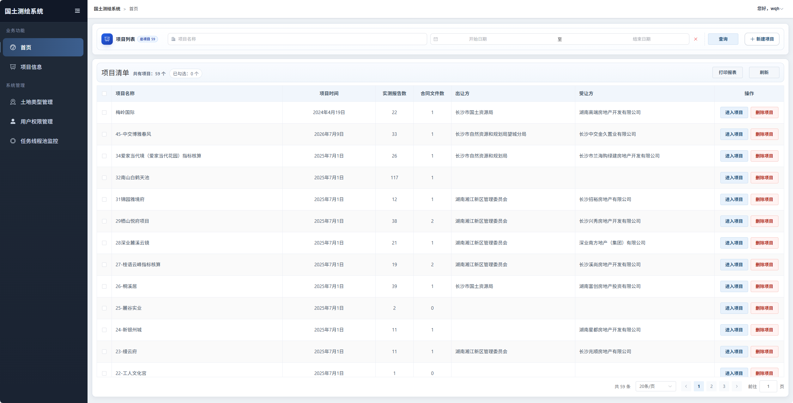
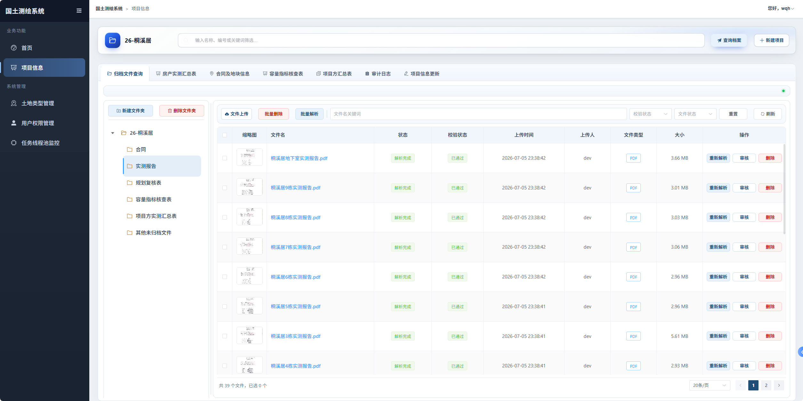
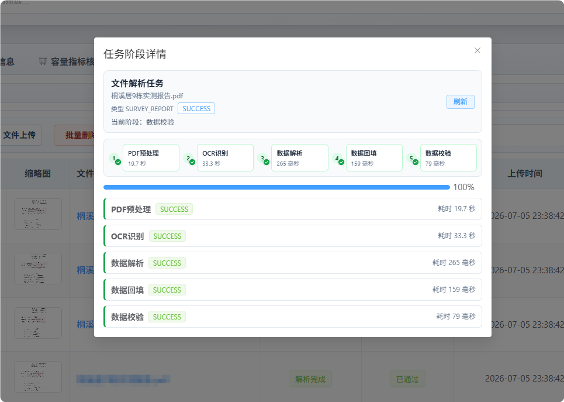
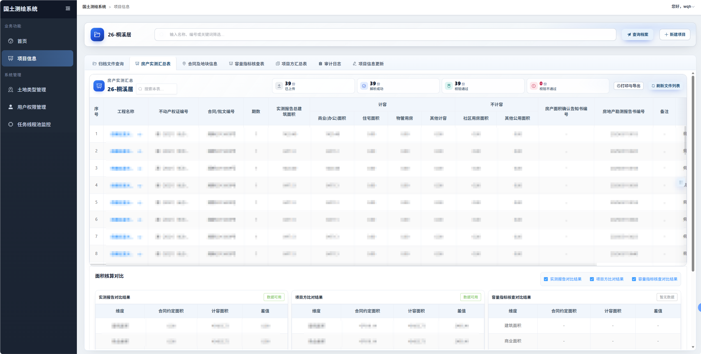

# LandCheck 前端

土地评估数据比对的 Web 端。对接后端 REST（Header `satoken`）和 STOMP 解析进度。

- 后端：[land-backend](https://github.com/HongxHH/land-backend)
- 测试机入口 `http://localhost:8090`：[TestDeploy](https://github.com/HongxHH/TestDeploy)

## 界面

首页：项目入口和状态。



项目归档：文件状态、解析进度。



解析流程：阶段进度和结果校准。



面积对照：系统口径、项目方声明、规划口径。




## 技术栈

| 项 | 说明 |
| --- | --- |
| Vue | 3.5 |
| 构建 | Vite 7 |
| UI | Element Plus（按需自动引入） |
| 路由 | Vue Router 4 |
| HTTP | Axios，Header `satoken` |
| 实时 | STOMP / SockJS，走同一条 `/api` 代理 |
| 表格 | ExcelJS、`@vue-office/excel` |
| Node | `^20.19.0` 或 `>=22.12.0` |

## 本地开发

```bash
npm install
npm run dev
```

打开 <http://localhost:5173>。未登录跳到 `/login`。

`/api` 在 `vite.config.js` 里反代，并去掉 `/api` 前缀。当前 `target` 是 `http://10.123.69.140:8082`。本机后端改成 `http://127.0.0.1:8082`。

校验：

```bash
npm run verify
```

依次执行 build、lint、测试，以及 ExcelJS 懒加载检查。

## 目录

```
src/
  views/          页面
  components/     按项目、上传、归档拆分
  composables/    组合式逻辑
  router/         路由与权限
  utils/          鉴权、文件状态、请求
  config/         功能开关
```
